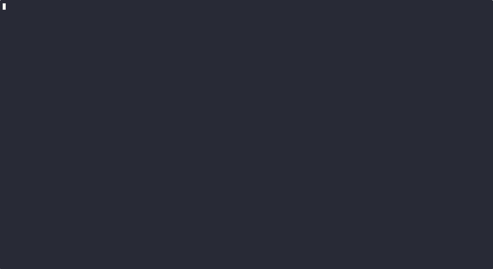

# RTP Stream Monitor

A Go application for monitoring and tracking the availability of Real-time Transport Protocol (RTP) streams in your network. The application discovers and displays stream information by subscribing to the actual stream data.

## Features

- **Tiling Terminal UI**: zellij-style panes, each bound to one stream, that you can add, move, resize, zoom and close
- **Headless Mode**: Command-line monitoring without UI for automation and logging
- **Stream Discovery**: Discover streams via mDNS, SAP, or static SDP files
- **Live VU Meters**: Real-time audio level visualization
- **RTCP log**: Detailed per-stream RTCP packet analysis
- **Real-time Updates**: Periodic refresh of stream status and statistics
- **WAV Recording**: Record any number of streams at the same time, each in its own pane
- **PTP Monitor**: If started with sufficient privileges, PTP time transmitters will be monitored and their equivalent RTP timestamp will be displayed in the stream details view.
- **FPGA RX streaming**: Support for Ravenna FPGA stream receiver (only available on Linux with special hardware)

## Demo



## Installation

### Prerequisites

- Go 1.26 or later

### Build from Source

```bash
git clone https://github.com/holoplot/rtp-monitor.git
cd rtp-monitor
go mod download
go build -o rtp-monitor
```

### Build with Make

The project includes a Makefile for easy development:

```bash
make build      # Build the application
make run        # Build and run the application
make clean      # Clean build artifacts
make test       # Run tests
make version    # Show version information
make release    # Build for multiple platforms
```

### Version Information

The application uses `git describe` to automatically determine version information:

- **On a git tag**: `v1.0.0`
- **After a tag**: `v1.0.0-5-gabcdef0` (5 commits after v1.0.0)
- **With changes**: `v1.0.0-5-gabcdef0-dirty`
- **No tags**: `abcdef0` (commit hash only)

```bash
# Check embedded version info
./rtp-monitor version
# Output: v0.8-12-ga55f82b-dirty (commit: a55f82b, built: 2025-12-03 09:42:30 UTC, go: go1.25.4 X:nodwarf5)

# Build with custom version (optional)
make build VERSION=v2.0.0-custom

# View build variables
make version
```

## Usage

### Terminal User Interface

Launch the interactive terminal interface:

```bash
./rtp-monitor
```

You can also load SDP files for manual stream configuration:

```bash
./rtp-monitor --sdp stream1.sdp --sdp stream2.sdp
```

### Headless Mode

Run in headless mode for automated monitoring without UI:

```bash
# Basic headless mode - logs discovered/disappeared streams
./rtp-monitor --headless

# Monitor specific streams by ID hash with periodic reports
./rtp-monitor --headless --hash 71cb8481ed --hash 850fab871a
```

**Note**: `--hash` can only be used with `--headless`. When monitoring specific streams, the application will:
- Create RTP receivers for each monitored stream
- Report packet rates and sequence errors periodically
- Log when monitored streams appear or disappear

### Command Line Options

```bash
Usage:
  rtp-monitor [flags]

Flags:
    --headless                   Run in headless mode (no UI)
-h, --help                       help for rtp-monitor
    --interface stringArray      Network interface to use (can be used multiple times)
    --no-mdns                    Disable mDNS discovery
    --no-sap                     Disable SAP discovery
    --report-interval duration   Report interval for stream monitoring in headless mode (default 1s)
    --hash stringArray           Stream ID hash to monitor in headless mode (can be used multiple times)
    --sdp stringArray            SDP file to parse (can be used multiple times)
-v, --version                    version for rtp-monitor
    --wav string                 Folder to save WAV files
```

## Terminal UI

The UI is a tiling layout of panes, similar to zellij. It starts with a single
pane that lists all discovered streams. Opening a view for a stream adds a
pane. Each pane is bound to one stream, so you can for example watch the
meters of one stream while recording two others.

Panes survive their stream disappearing: the border turns red, the title says
`gone`, and the pane reattaches when the stream is announced again. A record
pane keeps writing while packets arrive and starts new files if the stream's
format changes.

### Modes

Keys are grouped into modes, like in zellij. The status bar at the bottom
shows the current mode and its keys. `Esc` or `Enter` returns to Normal mode.

| Mode | Enter with | Keys |
|---|---|---|
| Normal | | keys go to the focused pane · `Tab` / `Shift+Tab` cycle focus · `c` copy · `Ctrl+c` quit |
| Pane | `Ctrl+w` | `←↓↑→` / `hjkl` move focus · `x` close · `f` zoom · `t` flip split direction · `c` copy · `r` Resize mode · `m` Move mode |
| Resize | `r` in Pane mode | `←↓↑→` / `hjkl` grow toward a side · `HJKL` shrink · `+` / `-` grow / shrink |
| Move | `m` in Pane mode | `←↓↑→` / `hjkl` swap with a neighbour · `Tab` swap with the next pane |

`Ctrl+w` also leaves any mode. The key scheme avoids zellij's and tmux's
default bindings, so rtp-monitor runs inside either without conflicts.

### Stream list

- `↑`/`k`, `↓`/`j`, `Page Up`, `Page Down`, `Home`, `End`: select a stream
- `m`: meters · `R`: record WAV files · `d`: details · `s`: SDP · `r`: RTCP log · `f`: FPGA RX (Linux with the Ravenna FPGA device only)
- `c`: copy the selected stream's SDP to the clipboard
- `q`: quit

New panes are placed automatically by splitting the largest pane. Focus stays
on the stream list, so you can open several panes in a row.

### Other panes

- `↑`/`k`, `↓`/`j`, `Page Up`, `Page Down`, `Home`, `End`: scroll
- `c`: copy the pane's content to the clipboard
- `Enter`: retry after an error

### Mouse

- Click a pane to focus it; click a row in the stream list to select it
- Drag the border between two panes to resize them
- Drag a pane by its title bar onto another pane to swap them
- Use the mouse wheel to scroll the pane under the pointer
- Hold `Shift` while dragging to select text (in most terminals)

When recordings are running, quitting asks for confirmation. All WAV files are
finalized on exit.

## Dependencies

- [Cobra](https://github.com/spf13/cobra): CLI framework
- [Bubble Tea v2](https://github.com/charmbracelet/bubbletea): Terminal UI framework
- [Lip Gloss v2](https://github.com/charmbracelet/lipgloss): Terminal styling and layout

## Contributing

1. Fork the repository
2. Create a feature branch
3. Commit your changes
4. Push to the branch
5. Open a Pull Request

## License

This project is licensed under the MIT License - see the LICENSE file for details.
